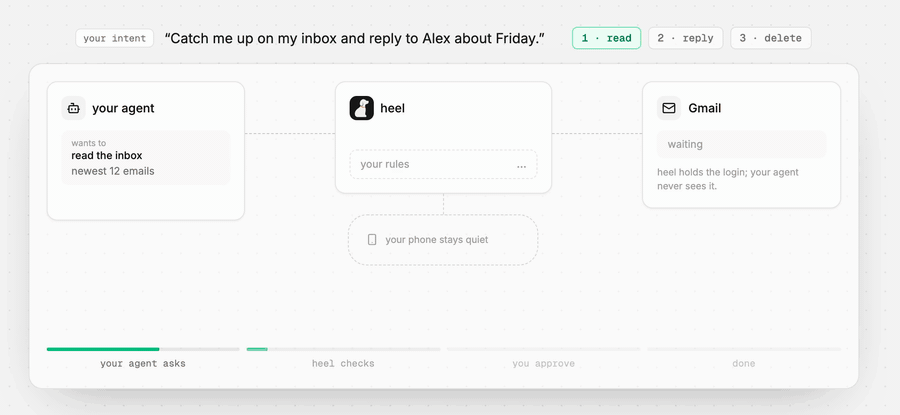

<p align="center">
  
</p>

<h1 align="center">heel</h1>

<p align="center">
  <strong>Your agent has the tools. heel decides what it does with them.</strong><br>
  Intent-based access control for AI agents. Open source and self-hosted.
</p>

<p align="center">
  <a href="LICENSE"></a>
  <a href="https://www.npmjs.com/package/useheel"></a>
</p>

heel sits between an agent and everything it touches (MCP servers, HTTP APIs and CLIs). It holds the credentials and checks every call against rules on the call's actual arguments: who an email goes to, which account it comes from, which repo, how many messages this run has deleted. It also hides what an agent shouldn't read. Calls that need a person go to the owner's phone, outside the agent's session. One switch pauses any agent.

[](assets/heel.mp4)

## Install

```sh
npm install -g useheel                      # Node 26.13 or later; installs the heel command
docker pull ghcr.io/akhileshrangani4/heel    # or run the OCI image
```

## Quick start

```sh
export HEEL_HOME=~/.heel                    # heel's config, keys and database
heel vault init                             # creates the master key: back it up
heel serve                                  # agents on :7300, approvals on :7301
```

In a second terminal, with the same `HEEL_HOME`:

```sh
heel user enroll owner                      # open the link and register your passkey
gh auth token | heel connect github --as github --credential-stdin
heel agent add my-agent                     # prints the agent's token and MCP URL
```

Then write your rules to `$HEEL_HOME/rules/owner.yaml`. A call no rule matches is denied:

```yaml
rules:
  - match: { kind: read }
    then: allow
  - match: { action: github.merge, repo: { one_of: [acme/web] }, checks: passing }
    then: ask
```

Run `heel rules check` to validate them. Then point your agent's MCP client at the printed URL, with `Authorization: Bearer <token>`. Reads go through, merges to `acme/web` with passing checks wait for your approval on the approval page, and everything else is denied.

To connect Claude Code, Cursor or another agent, and see what it's like to use day to day, read [Using heel](docs/using-heel.md). To run heel as a server with Docker, see [docs/running.md](docs/running.md).

## What it does

- **Rules on arguments.** One YAML file covers MCP, HTTP and CLI calls. Rules can check recipients, accounts, repos, CI status and threads, and count items per run or per hour. The first match decides, and nothing matched means deny. See [rules](docs/rules.md).
- **Hiding.** Mail from people you name, password resets and login codes never reach the agent. See [hiding](docs/rules.md#hiding-what-the-agent-reads).
- **Approvals the agent can't answer.** An `ask` waits for its owner, who approves with a passkey after seeing the full arguments. An approval can become a grant. See [approvals](docs/approvals.md).
- **Pause.** One command or one tap stops an agent, an account, or everything. See [pause](docs/approvals.md).
- **Every surface.** Built-in definitions for Gmail, Outlook, Calendar, GitHub, Slack, Linear, Notion and Stripe. Any MCP server, any HTTP API with an OpenAPI file, and any CLI through `heel run`. Code mode runs scripts in a sandbox. See [how it works](docs/how-it-works.md).
- **No model decides a live call.** Rules, grants and people do. See [why heel](docs/why.md).

## Docs

The docs are at **[useheel.dev](https://useheel.dev)**, and in [`docs/`](docs).

| | |
| --- | --- |
| [Using heel](docs/using-heel.md) | What it's like day to day: connecting your agent, what it sees, approving from your phone |
| [Why heel](docs/why.md) | The problem, intent-based access control, and where heel comes from |
| [How it works](docs/how-it-works.md) | Surfaces, code mode, the trust boundary, teams |
| [Rules and hiding](docs/rules.md) | The rules file, state checks, counts, `hide` |
| [Approvals, grants and pause](docs/approvals.md) | What happens on `ask`, and how to stop everything |
| [Running heel](docs/running.md) | npm, Docker, configuration, the sandbox |
| [Incidents](docs/incidents.md) | Four real incidents, replayed against heel |
| [How it compares](docs/comparison.md) | Other gateways and approval tools |
| [Releasing](docs/releasing.md) | How versions are cut and published |

## License

Apache 2.0. See [LICENSE](LICENSE).
