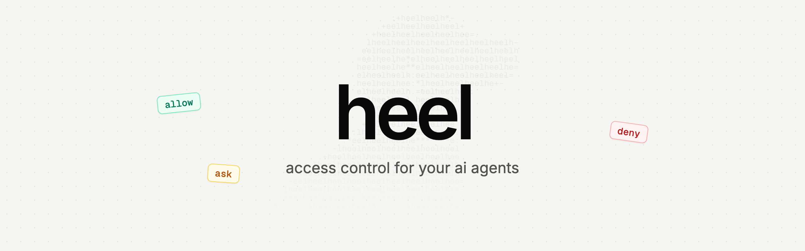
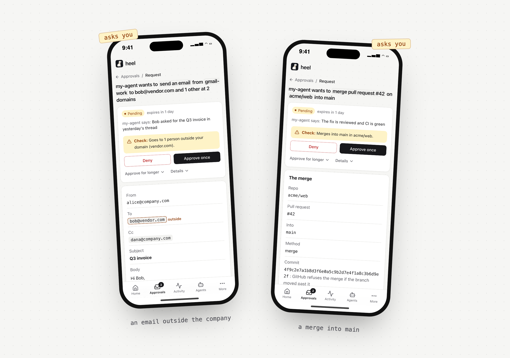

<p align="center">
  <picture>
    <source media="(prefers-color-scheme: dark)" srcset="assets/readme/banner-dark.png">
    
  </picture>
</p>

<p align="center">
  <strong>Your agent has the tools. heel decides what it does with them.</strong><br>
  Intent-based access control for AI agents. Open source and self-hosted.
</p>

<p align="center">
  <a href="LICENSE"></a>
  <a href="https://www.npmjs.com/package/useheel"></a>
</p>

heel sits between an agent and everything it touches (MCP servers, HTTP APIs and CLIs). It holds the credentials and checks every call against rules on the call's actual arguments: who an email goes to, which account it comes from, which repo, how many messages this run has deleted. It also hides what an agent shouldn't read. Calls that need a person go to the owner's phone, outside the agent's session. One switch pauses any agent.

<a href="assets/heel.mp4">
  <picture>
    <source media="(prefers-color-scheme: dark)" srcset="assets/heel-dark.gif">
    
  </picture>
</a>

## Get started

Tell your agent (Claude Code, Codex or any coding agent):

```text
Set up heel for me by following https://useheel.dev/setup.md
```

It installs heel, connects itself and puts your services behind heel. You make a passkey and approve each connection and rule ([Set up heel with one prompt](docs/setup.md)).

Or by hand:

```sh
npm install -g useheel          # Node 26.13 or later
heel init                       # master key, heel.yaml and starter rules
heel start                      # runs in the background: agents on :7300, approvals on :7301
```

Then create your passkey, connect GitHub and point your agent at heel: the **[Quickstart](docs/quickstart.md)** takes about 10 minutes. heel also runs in Docker: `ghcr.io/akhileshrangani4/heel` ([Running heel](docs/running.md)).

## What you approve

When a rule says `ask`, you see exactly what the call will do, in plain words, and decide with your passkey, on your phone if you like:

<p align="center">
  <picture>
    <source media="(prefers-color-scheme: dark)" srcset="assets/readme/approvals-dark.png">
    
  </picture>
</p>

## What a rule looks like

```yaml
rules:
  - match: { kind: read }                          # reads run
    then: allow
  - match:                                         # coworkers already in the thread
      action: email.send
      recipients: { all_in_thread: true, all_domain_in: [company.com] }
    then: allow
  - match: { action: email.send }                  # every other email asks
    then: ask
  - match: { action: github.merge, repo: acme/web, checks: passing }
    then: allow
```

The first rule that matches decides, and a call no rule matches is denied. Rules check what a call actually does: who an email goes to, which repo, how many messages this run has deleted. See [Rules](docs/rules.md).

## What heel won't do

- **Rules decide every call, not a model.** Allow, deny and ask come from your rules, grants and people. Whoever shapes a call (say, an injected instruction in an email) could shape a model judging it too. A model is involved in two places, and neither can let a call through: `looks_like` can only hide a message (and hides it when unsure), and the optional [hints](docs/hints.md) are advice on the approval page.
- **Checking calls doesn't stop every prompt injection.** When each call in an attack is allowed, nothing gets blocked. heel narrows where data can go and what an agent can destroy.
- **heel must hold every credential.** A token you also gave the agent directly goes around it.
- **An agent that can read heel's files isn't controlled by it.** Run heel where your agents can't reach its files: on another machine, as its own user, or in Docker.
- **Down means denied.** If heel is down, every call fails until it's back.

## Docs

The docs are at **[useheel.dev](https://useheel.dev/docs)**, and in [`docs/`](docs).

- **Get started:** [Quickstart](docs/quickstart.md)
- **Guides:** [Connect accounts](docs/connect.md) · [Connect your agent](docs/agents.md) · [Rules](docs/rules.md) · [Approvals](docs/approvals.md) · [heel run](docs/heel-run.md) · [Google sign-in](docs/google-sign-in.md) · [Running heel](docs/running.md)
- **Concepts:** [How it works](docs/how-it-works.md) · [Why heel](docs/why.md) · [How it compares](docs/comparison.md) · [Incidents](docs/incidents.md)
- **Reference:** [CLI](docs/cli.md) · [Configuration](docs/configuration.md) · [Rules reference](docs/rules-reference.md) · [Built-in services](docs/definitions.md) · [Hints](docs/hints.md)

Working on heel itself? See [CONTRIBUTING.md](CONTRIBUTING.md).

## License

Apache 2.0. See [LICENSE](LICENSE).
