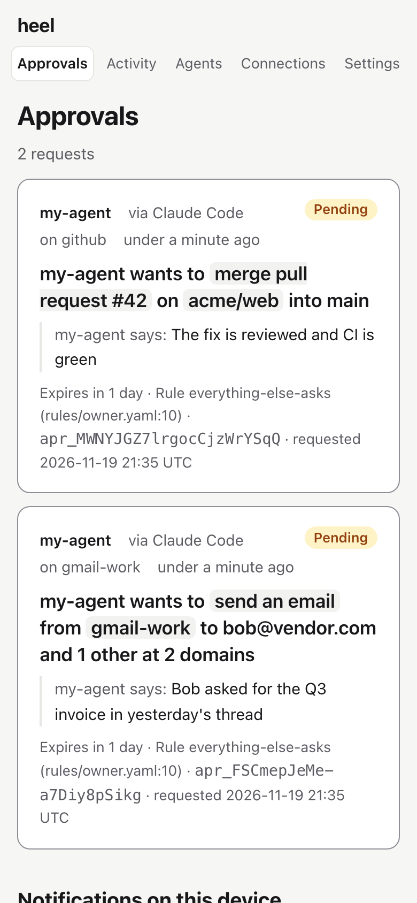
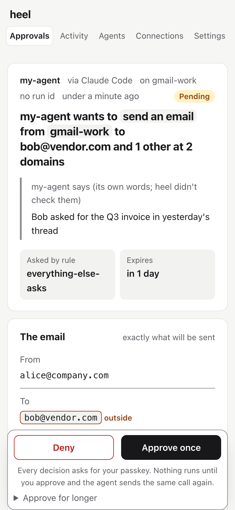
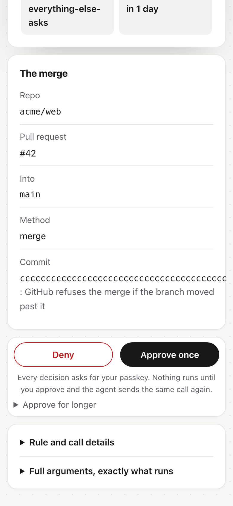
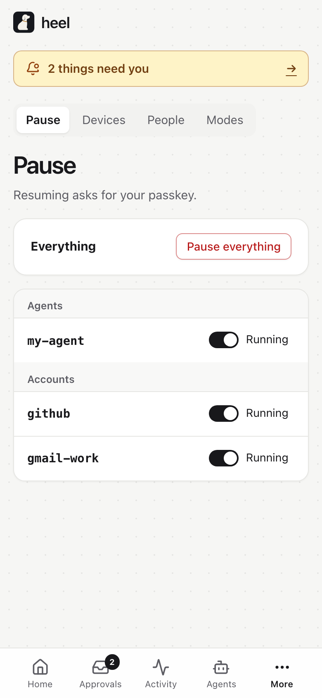

# Approve requests

When a rule says `ask`, the call waits until you decide with your passkey. This page covers the approval page, approving from your phone and stopping everything.

## What you see

Waiting requests are on **Approvals**, newest first. Each row says what the agent wants to do. You also get a notification if you turned them on.



Open a request to see what will run, in this order:

- **The summary:** one sentence, the status and when it expires.
- **The agent's note,** labelled as its own words, if it gave one.
- **The risk line,** when there is one, built only from the call: "Goes to 41 people outside your domain", "Merges into main".
- **Deny** and **Approve once.** On a phone they're on screen as soon as the page opens.
- **Approve for longer** and **Details** (agent, client, account, rule, counts and the full arguments).
- **The content itself:** for an email every recipient, the subject, the whole body and the attachments.



When the call comes from a code-mode script, the page also shows the script: the calls it made and its code. Approving lets the script carry on from that call. **Stop the script** (no passkey) ends it, whatever you decide.

## Decide

Every decision asks for your passkey.

- **Approve once:** this exact call runs once, when the agent sends it again (or straight away if it's still waiting).
- **Approve for longer:** this call, or everything the rule asks about, runs for this agent for an hour up to 30 days. Editing the rule ends it.
- **Deny:** the agent gets "denied".

A request nobody answers expires after 24 hours.



Approvals for longer are listed under **Agents**, **Standing approvals**, where you can revoke them. **Grants** (**Agents**, **Grants**) work the same way ahead of time: a narrow allow for one agent and one task, signed with your passkey, never past a `deny`.

## Approve from your phone

Your phone needs heel's approval page at an HTTPS address, set before you create your passkey: a passkey only works on the address it was made on.

**With Tailscale** (private to your devices), on heel's machine with Tailscale signed in and HTTPS certificates on:

1. Set it up:
   ```sh
   heel init --approve-from tailscale
   ```
   The approval page goes on port 443 and the agent plane on 8443. If Tailscale already serves something else on one of them, heel leaves it alone, uses a free port from 7443 up, and says which.
2. Start heel and make your passkey link:
   ```sh
   heel start
   heel user enroll owner
   ```
3. Open the link on your phone, create the passkey, and turn on notifications on the welcome page.

**With a Cloudflare tunnel on your domain** (public, so heel warns at start), with `cloudflared` installed and `cloudflared tunnel login` done once:

```sh
heel init --approve-from cloudflare --hostname heel.example.com
```

heel creates a named tunnel and runs it with `heel start`. Use a name one level under your domain. Consider [Cloudflare Access](https://developers.cloudflare.com/cloudflare-one/policies/access/) in front of the approval page.

**By hand:** give port 7301 an HTTPS address (`tailscale serve --bg 7301`, a Cloudflare tunnel, or a reverse proxy with TLS), set it in `heel.yaml` and restart heel:

```yaml
public_url: https://heel.example.com
```

Then run `heel user enroll owner` and open the link on your phone.

**Notifications:** add the page to your Home Screen (an iPhone only notifies for pages added this way), then turn on the switch under **Settings**, **Devices**. Email and Slack can notify too: see `notify` in [configuration](configuration.md). If you change `public_url` later, create your passkey again.

## Stop everything

Open **Settings**, **Pause**: each agent and account has a switch. Pausing is instant and needs no passkey; resuming asks for your passkey. Or from the command line:

```sh
heel pause --agent my-agent
```

(`--account` or `--all` work too.) Every call in scope stops at once, even one you already approved, and nothing is replayed after you resume.



## Rule changes

Rules your agent proposes, and rules heel suggests from what you decide, wait under **Rule changes** and **Suggested rules** on **Approvals**. Nothing changes until you add them with your passkey. See [write rules](rules.md#your-agent-can-propose-rules).

## Hints

Hints are optional advice under a waiting request, such as "asks someone for money" or "unlike this agent's recent calls". They're off by default and never decide anything.

heel's built-in hint source is **Jev**, [TypeSafe](https://typesafe.ai)'s decision model. For each waiting request it checks for passwords or keys, card or ID numbers, requests for money or access, and calls unlike the agent's recent work. It shows a hint only when it's sure (above 0.7), says "hints unavailable" when it fails, and never shows a guess.

To turn hints on:

1. Create an API key in the [TypeSafe console](https://console.typesafe.ai). Each waiting request costs one TypeSafe request.
2. Save it where only you can read it (paste the key, Enter, then Ctrl-D):
   ```sh
   (umask 077 && cat > "$HEEL_HOME/typesafe-api-key")
   ```
   Or set `HEEL_TYPESAFE_API_KEY`, which takes precedence.
3. Turn the adapter on in `heel.yaml`, then run `heel restart`:
   ```yaml
   adapters:
     approval:
       - jev: { model: jev-latest }
   ```

**What leaves heel,** only for a call waiting for you: the agent's name, the call's account, tool and action, its arguments (the first 24,000 characters), and the account, tool, action and outcome of the agent's last 15 calls. Credentials are never sent. Remove the `adapters` block to turn hints off.
