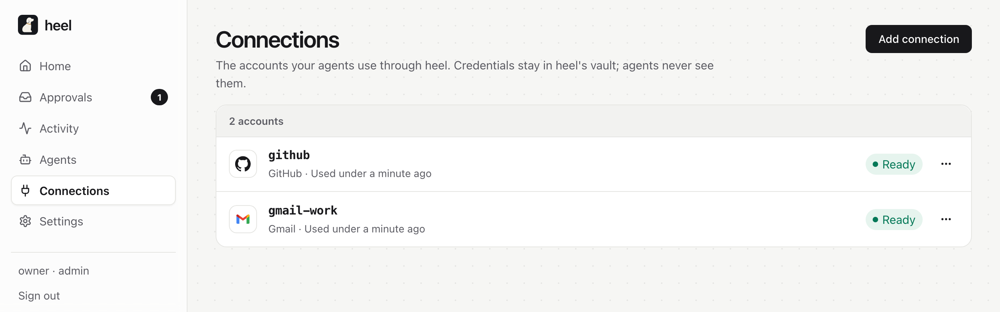

# Connect accounts

Put an account behind heel once, so your agents can use it without ever holding its credential.

heel keeps each credential encrypted on its own machine. Your agent only ever sees the account's alias, such as `github` or `gmail-work`. Run the commands on the machine heel runs on, with heel running.



## Built-in services

heel knows these services' tools, so rules can name what a call does (`action: github.merge`, `recipients: ...`) and the approval page shows it in plain words.

| Service | Connect it with | Credential |
| --- | --- | --- |
| **GitHub** | `gh auth token \| heel connect github --as github --credential-stdin` | A token: `gh auth token`, or a fine-grained token |
| **Slack** | `heel connect slack --as slack --credential-stdin` | A bot token (`xoxb-…`) |
| **Linear** | `heel connect linear --as linear --credential-stdin` | A personal API key (`lin_api_…`) |
| **Notion** | `heel connect notion --as notion --credential-stdin` | An internal integration secret |
| **Stripe** | `heel connect stripe --as stripe --credential-stdin` | A restricted key (`rk_…`) with only what the agent needs |
| **Gmail** | `heel connect gmail --as gmail-work` | Sign in with Google, no setup ([below](#google-sign-in)) |
| **Google Calendar** | `heel connect google-calendar --as calendar` | Sign in with Google, no setup |
| **Outlook** (mail and calendar) | `heel connect outlook --as outlook` | Sign in through your own Microsoft app (`providers.microsoft` in [Configuration](configuration.md)) |

1. Run the command. `--credential-stdin` reads the key from standard input, so it never lands in your shell history: pipe it in, or paste it and press Ctrl-D.
2. For a service that signs in, open **Connections** and select **Sign in** next to the account.

heel checks a pasted key with one read before storing it. A key the service turns down isn't connected, and heel says so. If heel can't settle it (no network, an outage, a restricted key that can't make that read), it connects the key and tells you it couldn't check.

## Google sign-in

Gmail and Google Calendar sign in with heel's own Google client, so there's nothing to set up.

1. Connect the account: `heel connect gmail --as gmail-work`.
2. On **Connections**, select **Sign in**, then **Continue to Google**.
3. Sign in and allow everything heel asks for. If Google says it hasn't verified heel yet, select **Advanced**, then **Go to heel**. Your data still goes only to your own heel.
4. **On the computer heel runs on,** you land back on Connections, signed in.
   **With heel on a server, another device or in Docker,** Google's last page won't load, because its address starts with `http://127.0.0.1`. That's expected. Copy that address, go back to heel's tab and select **Paste and finish**. If the browser won't let heel read the clipboard, paste it into the box and select **Finish signing in**.

Each sign-in works once, for the person who started it, within 10 minutes. heel's Google client comes with the npm package and the Docker image; a heel built from a git checkout doesn't have it, so use your own client. Until Google verifies heel, at most 100 people can sign in with heel's client.

**What heel asks Google for:**

- Gmail: `gmail.modify` (read, search, label, send, move to trash) and `gmail.settings.basic` (filters, which your rules decide on).
- Calendar: `calendar.events` (read and edit events) and `calendar.calendarlist.readonly` (find your primary calendar).
- Never full mail access, so a delete is always a move to the trash. What an agent may actually do is up to your [rules](rules.md).

### Use your own Google client

For a team past Google's limit, a Workspace that only allows approved apps, or a git checkout. It takes about 10 minutes, once, and wins over heel's client when it's set.

1. In the [Google Cloud console](https://console.cloud.google.com/), create a project and enable the **Gmail API** (and the **Google Calendar API**).
2. Under **Google Auth platform**, set up the consent screen. Choose **External** for personal Gmail and add every account you'll connect as a test user, or **Internal** if every account is in your Workspace.
3. Create a client of type **Web application** with this redirect URI, and copy the client ID and secret (Google shows the secret once):
   ```
   <public_url>/oauth/google/callback
   ```
   With no `public_url` set, that's `http://localhost:7301/oauth/google/callback`. It must match exactly: scheme, host and port.
4. Save the secret where only heel's user can read it:
   ```sh
   (umask 077; read -rs secret; printf '%s\n' "$secret" > "${HEEL_HOME:?set HEEL_HOME first}/google-client-secret")
   ```
   Paste the secret and press Enter. Run it as heel's user, not with `sudo`. Or set `HEEL_GOOGLE_CLIENT_SECRET` instead.
5. Add the client ID to `$HEEL_HOME/heel.yaml`, then `heel restart`:
   ```yaml
   providers:
     google:
       client_id: 1234567890-abcdefg.apps.googleusercontent.com
   ```
6. Sign in from **Connections** as above.

An External app in **Testing** signs you out after 7 days. Sign in again each week, publish the app on its **Audience** page, or use Internal.

### Troubleshooting Google sign-in

- **`redirect_uri_mismatch`:** the client's redirect URI doesn't match `<public_url>/oauth/google/callback` character for character (`http` or `https`, `localhost` or `127.0.0.1`, the port). A new URI can take a few minutes to apply.
- **`access_denied` or "access blocked":** the app is in Testing and that Google account isn't a test user.
- **"heel couldn't read the mailbox's address":** the Gmail or Calendar API isn't enabled in your project.
- **"Google sent no refresh token":** remove heel's access at [myaccount.google.com/permissions](https://myaccount.google.com/permissions) and sign in again.
- **"That isn't the address Google sent you to":** paste the address of Google's last page for this sign-in (it starts with `http://127.0.0.1:` and has `state=` and `code=`), within 10 minutes.

## Any MCP server

**A remote server:**

```sh
heel connect mcp --as notes --url https://mcp.example.com/mcp --oauth
```

With `--oauth`, sign in from **Connections**. For a server that takes a token, use `--credential-stdin` instead.

**A local server** (a command heel starts) runs in heel's sandbox, on Linux. Name the hosts it talks to, and it gets a placeholder instead of the credential:

```sh
heel connect mcp --as notes --command /usr/bin/node --arg /opt/notes/server.js \
  --egress api.notes.example --credential-env NOTES_TOKEN \
  --credential-host api.notes.example --credential-stdin
```

For a server heel doesn't know, rules match on its own tool and argument names. [Security](security.md) has how the credential stays outside the sandbox.

## Any HTTP API

```sh
heel connect http --as tickets --base-url https://api.tickets.example \
  --openapi ./tickets-openapi.yaml --auth bearer --credential-stdin
```

Your agent calls it at `http://127.0.0.1:7300/http/tickets/<path>` with its heel token. `--auth` is `bearer`, `basic`, `header:<Name>` or `query:<name>`.

To give your rules the same `action` and `kind` built-ins have, add these keys to each operation in the OpenAPI file:

| Key | Value | Rules can then say |
| --- | --- | --- |
| `x-heel-action` | A name like `tickets.close` | `action: tickets.close` |
| `x-heel-kind` | `read` or `write` | `kind: read` (only an explicit `read` counts) |
| `x-heel-hide` | Where email-shaped items sit in a response | Your `hide` entries apply here too |

Paths the file doesn't describe still go through heel, matched on `method` and `path`. The [rules reference](rules-reference.md) has every key an HTTP account can match.

## Any CLI with heel run

`heel run` lets an agent use a CLI such as `gh` or `npm` without holding its credential. heel checks the command against your rules and runs it itself, in a sandbox on heel's machine, then sends back the output and exit code.

You need heel on **Linux with bubblewrap**, or in Docker with the options below (on a Mac, run heel in Docker), and the `heel` command where the agent runs.

1. **Connect the CLI.** `--bin` is its path on heel's machine, a real file outside every workdir:
   ```sh
   gh auth token | heel connect cli gh --as gh --bin /usr/bin/gh --credential-stdin
   ```
2. **Allow it in your rules.** A command no rule matches is denied. gh commands on a repo need `-R <owner>/<repo>`:
   ```yaml
   rules:
     - match: { command: gh, kind: read }
       then: allow
     - match: { command: gh }
       then: ask
   ```
3. **Give the agent a workdir,** a directory its commands may run in. Setting replaces the list, so name every one. The agent can also propose one with `heel_propose_rules`, which you add with your passkey.
   ```sh
   heel agent workdir my-agent /home/me/code
   ```
4. **Point the agent at heel,** where the agent runs:
   ```sh
   export HEEL_TOKEN=heel_…              # the agent's token
   export HEEL_URL=http://127.0.0.1:7300 # heel's agent plane, no /mcp
   ```
5. **Check it** from inside the workdir:
   ```sh
   cd /home/me/code/web && heel run -- gh pr list -R acme/web
   ```

The agent can add `--reason "…"`, which shows on the approval page as its own words.

**The directory has to be the same on both sides.** The command runs on heel's machine, in heel's copy of the directory, at the path the agent sent. heel and the agent on one machine works. heel in Docker works when the project is mounted at the identical path (`-v /home/me/code:/home/me/code`). Mounted at a different path, or not at all, the agent gets `workdir_not_allowed`.

**heel in Docker** needs two options so bubblewrap can create its sandbox, plus a Linux build of the CLI:

```sh
docker run -d --name heel \
  --security-opt seccomp=unconfined --security-opt systempaths=unconfined \
  -p 127.0.0.1:7300:7300 -p 127.0.0.1:7301:7301 \
  -v heel-data:/var/lib/heel -v "$HOME/code:$HOME/code" \
  -v "$HOME/heel-bin/gh:/usr/local/bin/gh:ro" \
  ghcr.io/akhileshrangani4/heel
```

Then run the setup through `docker exec -i heel heel …`, with `--bin /usr/local/bin/gh`.

**When it doesn't run,** `heel run` prints a `heel:` line and exits with 75 (needs approval, or busy), 77 (denied), 69 (paused), 70 (couldn't run) or 64 (usage error):

- `workdir_not_allowed`: the directory isn't inside a workdir, or heel can't find that path on its side.
- `unknown_endpoint`: no CLI account for that command, or `HEEL_URL` ends in a path such as `/mcp`.
- `unknown_host`: `HEEL_URL` uses a name heel doesn't serve. Use `127.0.0.1`, or set `listen.agent` to that name in heel.yaml.
- `unsupported`: heel can't check the command. For gh, add `-R <owner>/<repo>`.
- `sandbox_unavailable`: heel's machine can't run the sandbox (macOS, or Docker without the options above). `heel logs` says why.

## From the web app

On **Connections**, **Add connection** opens a grid of services. Pick one, give it a name (and a key, for services that use one), and confirm with your passkey. Each account's **⋯** menu replaces its key or removes it, with your passkey.

## Your agent can ask

When your agent needs an account you haven't connected, it asks with `heel_request_connection` instead of asking you to run `heel connect`. You're notified, and the request waits on the Approvals page until you connect it with your passkey (signing in, or pasting the key on heel's page). The agent never handles a password or key, and learns nothing about which accounts you already have.

## Change or remove an account

- **New key:** after rotating it with the provider, give heel the new one. Every setting stays.
  ```sh
  printf %s "$NEW_TOKEN" | heel account set github --credential-stdin
  ```
  Accounts that sign in sign in again from **Connections**.
- **Remove:** `heel account remove github` deletes the account and its credential, and revokes approvals and grants that name it. Revoke the credential with the provider too.
- **List:** `heel account list`.

Remove the agent's own access to each account you connect (its GitHub MCP server, its `gh` login, its API keys), or it can go around heel.
