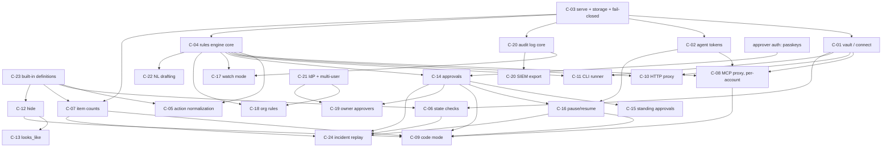

> **Exported from the Obvious project `prj_rqc5uhH3`.** Source: *heel research — requirements map* (document `art_RNJqRJci`), last updated 2026-11-13T19:50:44.701Z. Export date: 2026-11-17.

# heel research — requirements map

**Source:** `akhileshrangani4/heel` @ `0627f55` ("Shorten the video, add a license, watch mode, and fail-closed behavior"). The repo holds `README.md` (208 lines, read in full), `LICENSE` (Apache 2.0), `.gitignore`, and `assets/heel.gif` + `assets/heel.mp4` (25.5 s). There is no code yet.

**How to read this document**

- Requirements cite the README section in brackets, e.g. **\[Rules\]**. Quotes are verbatim. Paraphrases stay close to the README text.
- **(inferred)** marks anything I derived and did not read directly. **(video)** marks something I saw in frames sampled from `heel.mp4` (one frame every 2 s). The video is a marketing demo, not a spec.
- README section names used below: *Intro* (the text above "The problem"), *The problem*, *How it works* (code block + CLI block), *Trust boundary*, *Every way an agent reaches a system*, *Rules*, *Hiding what the agent reads*, *Approvals*, *Pause*, *For teams*, *Built-in definitions*, *Incidents heel would have stopped*, *How it compares*, *Where this comes from*.

> **Load-bearing assumption:** The brief treats the README as a complete enough product contract to slice an MVP from it. That holds for the *behaviors*. It does not hold for the *mechanics*: how the agent sends a run id, how an approved call is re-run, how a CLI runner mounts a working directory across the trust boundary, and where the approval page is hosted are all left unstated. The spec must lock those decisions (§5) before any slice can be built. Evidence that would break this assumption: a separate design note from the author that already fixes these mechanics. I found none in the repo.

---

## 1. Capability inventory

Each capability gets an ID (`C-xx`) that the dependency graph and MVP options refer to.

### C-01 Credential vault + `heel connect`

**\[How it works\]** `heel connect gmail --as gmail-work # OAuth; the token stays in heel`, then a second account with `--as gmail-personal`, plus `heel connect github --as github`.  
**\[Trust boundary\]**

- "heel holds every credential." The agent never receives provider tokens.
- "A token you also gave a client directly goes around heel." That includes built-in connectors left connected next to heel, such as Claude's or ChatGPT's Gmail connector. This is a documented limitation, not something heel enforces.

Requirements:

- `connect <provider> --as <alias>` runs OAuth and stores the token inside heel.
- The same provider can be connected several times under different aliases. The alias becomes the account name used in rules (`account: gmail-personal`) and the per-account MCP server name.
- State checks reuse these credentials: "using heel's own read access to that service" **\[Rules\]**.
- The CLI runner puts credentials into the command's environment **\[Every way… / CLIs\]**, and the HTTP proxy "adds the credentials" **\[Every way… / HTTP APIs\]**.

### C-02 Agent identity + `heel agent add`

**\[How it works\]** `heel agent add inbox-bot # prints the agent's heel token and MCP URL`.  
**\[Trust boundary\]** "Each agent gets its own heel token and nothing else. That token is how heel tells agents apart, pauses one of them, and logs what each did."

Requirements:

- Every request on every surface (MCP, HTTP, CLI) is authenticated with an agent token.
- The token identifies the agent for rules, per-hour counts ("counts per agent"), pause, and the audit log.
- `agent add` prints both the token and the agent's MCP URL.

### C-03 Server process `heel serve` + deployment boundary

**\[How it works\]** `heel serve`. **\[Rules\]** `heel serve --watch` (see C-17).  
**\[Trust boundary\]**

- "heel has to run where the agent can't reach it, for example a separate server, container, or user. An agent that can read heel's files or the provider tokens can go around it."
- "If heel is down, calls fail. Every call is denied until heel is back, never let through."

### C-04 Rules engine (file, ordering, matching, decisions)

**\[Rules\]**

- "Rules are a file you can read, review, and test."
- Evaluation order, first match decides:
  1. Organization rules, which deny or ask only.
  2. Standing approvals, each "just above the rule that asked for it".
  3. "Your rules, from top to bottom."
- "A call no rule matches is denied."
- Decisions: `then: allow | deny | ask`.
- Match keys shown in the example: `kind` (e.g. `read`), `action` (e.g. `email.send`, `email.remove`, `github.merge`), `account`, `recipients` (with `any_domain_in`, `all_in_thread`, `all_domain_in`, `max`), `items` (`over`, `per`), `repo` (`one_of`), `checks` (`passing`), `command`, `verb` (scalar or `one_of`).
- "Plain checks work on anything: `equals`, `one_of`, `matches`, `any_domain_in`, `all_domain_in`, `max`, and counts."
- "For a server heel doesn't know, rules use its own tool and argument names."
- Per-rule watch mode: `watch: true` (see C-17).
- **\[Every way… / HTTP APIs\]** HTTP rules match on "method, path, query, and body".
- **\[Every way… / CLIs\]** CLI rules match on `command` and `verb` for known CLIs, and on "the raw arguments" for unknown ones.

### C-05 Action normalization (definitions → actions, `kind`)

**\[Rules\]**

- "Built-in definitions map tools from different servers to one action."
- "`email.send` covers send, reply, reply-all, and forward on Gmail and Outlook servers, with `recipients` meaning to, cc, and bcc together."
- The YAML comments add: `kind: read` means "anything a built-in definition marks as read-only", and `email.remove` covers "trash, delete, and archive".
- **\[Incidents\]** "Reply-all is `email.send`." (Kiro#8500)

### C-06 State checks

**\[Rules\]** "State checks look something up first, using heel's own read access to that service."

- `all_in_thread`: "every recipient was on a message you sent in that thread, so someone who only emailed you doesn't count, and a new message isn't in a thread."
- `checks: passing`: "reads the pull request's status and passes the commit it checked to GitHub's merge call, so the merge fails if new commits landed in between."
- "State checks only exist for services heel knows."

### C-07 Item counts

**\[Rules\]**

- "Counts use `items` (messages, files, records) rather than calls, so one `batch_delete` of 1,000 messages counts as 1,000."
- "A count includes the call being checked."
- "The `per: run` period means the run id the agent sends with its calls."
- "Because the agent picks that id, pair a run limit with a `per: hour` limit, which counts per agent and can't be reset."
- "An agent that sends no run id is counted per hour only."
- Example: `items: { over: 20, per: run }` → ask, and `items: { over: 100, per: hour }` → ask.
- **\[Every way… / Code mode\]** "a loop over 500 messages hits the same item counts as 500 separate calls."
- (video) A `batch_delete` of 340 ids returns "pending approval, over 20 this run". The agent then shows "retrying with smaller batches…". The spec must decide whether smaller batches pass, which depends on whether the pending 340 counted (Q-C3).

### C-08 MCP proxy with per-account servers

**\[Every way… / MCP\]**

- "Point the client at heel's MCP URL. heel connects to the real servers, local or remote, and exposes each connected account as its own server (`gmail-work`, `gmail-personal`), so the agent always picks the account explicitly."
- "Clients that only offer built-in connectors can still add heel as a custom MCP server."
- **\[Incidents\]** The #96004 fix depends on this: "The two accounts are separate servers".

### C-09 Code mode (`run_code`)

**\[Every way… / Code mode\]**

- "by default heel's MCP server offers one `run_code` tool instead, with typed definitions for each connected account (`gmail_work.send(...)`, `github.merge(...)`)."
- "the script runs in a sandbox heel controls, with no network and no credentials, so its only way out is heel."
- "Every call inside the script goes through the rules one at a time."
- Item counts apply per call: a 500-message loop counts as 500 separate calls.
- "hidden messages never reach the script".
- "a paused agent's script stops on its next call."
- "When a call needs approval, the script stops there and returns the pending id along with what already ran, and the agent writes the rest as a new script once the call is approved."
- "Clients that work better with plain tools can get every tool listed directly instead."

The README makes code mode the default and plain tools the opt-in.

### C-10 HTTP proxy

**\[Every way… / HTTP APIs\]**

- "Send requests through heel, and it adds the credentials."
- "Rules match on method, path, query, and body."
- "Built-in definitions cover common APIs, and you can describe others with an OpenAPI file."
- **\[Approvals\]** A pending call returns "HTTP `202`".

### C-11 CLI runner `heel run`

**\[Every way… / CLIs\]**

- "`heel run -- gh pr merge 123` checks the command before it runs."
- "heel parses the flags of CLIs it knows, so `kubectl -n prod delete pod x` is still a `delete`."
- "it runs the binary directly, never through a shell, so `sh -c` and pipes can't hide a command."
- "The command runs in a runner heel controls, not on the agent's machine, with the agent's working directory mounted in. That way the agent can't swap the binary or read the credential heel puts in the command's environment."
- "Commands that print credentials, such as `gh auth token`, can never be allowed."
- "For a CLI heel doesn't know, rules match the raw arguments, and nothing runs until a rule allows it."
- **\[How it works\]** diagram: "any CLI (gh, gcloud, stripe, kubectl, ...)".
- **\[Approvals\]** A pending call returns "a CLI exit code".

### C-12 Result hiding (`hide`, plain checks)

**\[Hiding what the agent reads\]**

- "Rules decide whether a call runs. `hide` decides what comes back from it. It applies to every allowed call on every account, so a read rule can stay a plain `allow`."
- Example: `- email: { from: { any_of: [sarah@example.com] } }`.
- "Hidden messages drop out of the results. Searches, lists, and threads come back without them, with a placeholder that says how many were hidden, so the agent knows the list is incomplete without learning the sender or subject."
- "Fetching a hidden message by id, or forwarding, replying to, or deleting it, is denied."
- "`from`, `to`, `subject`, and `labels` are plain checks."
- "Hiding only works where heel knows the response shape. That covers built-in definitions and APIs described with an OpenAPI file. For an MCP server or CLI heel doesn't know, it can allow or deny the call but can't remove items from what comes back."
- "A hidden message can still show up quoted. If someone replies and quotes the hidden one, that reply only gets hidden if it matches too." This is a documented limitation.
- (video) Search results show a "hidden by heel" placeholder in place of each hidden row, plus a badge "ALLOW, FILTERED". The README describes a single placeholder giving a count. The spec must pick one (Q-H1).

### C-13 `looks_like` classifier

**\[Hiding what the agent reads\]**

- Example: `- email: { looks_like: [password_reset, login_code] }`.
- "`looks_like` is the one place a model decides on a live call."
- "Patterns catch common reset links and codes, and a classifier running inside heel catches the rest."
- "It sees each message before the agent does."
- "When it's unsure, or can't run, the message is hidden."
- "It can still miss one, which is why `looks_like` only ever hides and never allows."
- **\[Rules\]** "Apart from `looks_like` (below), a model never sees a live call."

### C-14 Approvals (ask → pending → approve/deny → run once)

**\[Approvals\]**

- "When a rule says `ask`, heel doesn't hold the agent's request open."
- The agent gets an immediate answer: "pending approval" with an id, delivered as "an MCP tool result, HTTP `202`, or a CLI exit code. The agent can keep working, or check back with the id."
- "Repeats join the same request. The approval is tied to the exact call, so an agent that retries the same call joins the same pending request instead of creating a duplicate."
- "heel pushes a notification to their phone, Slack, or email. The notification only links to heel's approval page, where the approver signs in with a passkey and sees the tool, the account, and the full arguments. Replying to the message approves nothing."
- "An approved call runs once. It runs when the agent asks for it, so a late approval never runs a call the agent has given up on. Unapproved requests expire."
- **\[Intro\]** "Approvals go to a signed-in person outside the agent's session, so the agent can't answer them itself."
- (video) Pending id shown as `apr_7f2k`. The approval page shows the agent name ("inbox-bot wants to send"), the account, `to`, the body, and approve/deny buttons. The agent log then shows "approved by avi, sent once".

### C-15 Standing approvals

**\[Approvals\]** "An approval can stand. Instead of covering this call only, it can add a rule ("allow this for 30 days") just above the rule that asked. Widening that rule asks again."  
**\[Rules\]** A standing approval "can turn that `ask` into `allow` but can't get past an earlier `deny`."

### C-16 Pause / resume

**\[Pause\]**

- "`heel pause` stops one agent, one service, or everything, from the CLI or the approval page on your phone."
- "While paused, every call gets a "paused" error, and pending approvals can't be approved."
- "After `heel resume`, the agent's next call goes through the rules as usual."
- **\[The problem\]** "Stopping a run usually means revoking credentials or killing the process." Pause is the answer to that.
- **\[Every way… / Code mode\]** "a paused agent's script stops on its next call."
- (video) The phone shows an agents list ("inbox-bot 1 pending", "deploy-bot running", "notes-bot running"), each row with a stop button.

### C-17 Watch mode

**\[Rules\]**

- "`heel serve --watch` lets every call through and logs what each rule would have done, so you can tune them on real traffic first."
- "A single new rule can also run in watch mode while the rest are enforced, with `watch: true` on that rule."

### C-18 Organization rules

**\[Rules\]** "These can only deny or ask, never allow, so nothing below them can loosen them."  
**\[For teams\]** "Admins set the ceiling. Organization rules are checked first and can only deny or ask, so no personal rule or approval can loosen them."

### C-19 Owner approvers

**\[For teams\]** "Owners approve. Each connected account, repo, or service names its approver, so the request goes to the person who owns it, not to IT for every call."

### C-20 Audit log + SIEM export

**\[For teams\]** "Every decision is logged. The log records the agent, the run, the arguments, the rule or approval that decided the call, and who approved it. It can be exported to your SIEM."  
**\[Trust boundary\]** The agent token is how heel "logs what each did".

### C-21 Identity provider sign-in + groups

**\[For teams\]** "Sign-in and groups come from your identity provider. Roles still decide what a person can reach; heel decides which part of that their agents can use."

### C-22 Natural-language rule drafting

**\[Rules\]** "You can describe a rule in words. A model drafts the YAML for you to read and save. Apart from `looks_like` (below), a model never sees a live call; every decision comes from the file and the data it names."

### C-23 Built-in definitions (providers)

**\[Built-in definitions\]**

- "These cover Gmail, Outlook, Calendar, GitHub, Slack, Linear, Notion, and Stripe."
- "In these definitions, tools that leave something behind after you revoke the agent are denied until you allow them by name. That includes forwarding rules, new OAuth grants, scheduled automations, and webhooks."

A definition carries several facets, each consumed by another capability:

- tool → action mapping and `kind: read` (C-05)
- argument normalization such as `recipients` = to + cc + bcc (C-04)
- item extraction (C-07)
- state lookups (C-06)
- response shape for hiding (C-12)
- typed code-mode bindings (C-09)
- HTTP surface (C-10)
- CLI flag parsing for gh, kubectl, etc. (C-11)
- the persistence-tool deny list (this capability)

### C-24 Incident replay (stated commitment)

**\[Incidents heel would have stopped\]** "We'll replay each of these against heel and publish exactly what was blocked and what got through."  
The four incidents are claude-code#99453, claude-code#96004, Kiro#8500, and OpenClaw clearing an inbox. Each row names "Rule that blocks it" and "What it wouldn't catch". This works as a ready-made acceptance suite (see §4).

### C-25 Scope disclaimer (non-goal)

**\[Incidents\]** "Checking calls doesn't stop every prompt injection. When each call in an attack is allowed, nothing gets blocked. heel narrows where data can go and what an agent can destroy, and it doesn't claim more than that."

---

## 2. Invariants

Each invariant is phrased so a test can pass or fail on it. **Src** is the README section. Items marked (inferred) are required to keep a stated invariant true; the README does not say them.

### Trust and availability

| #    | Invariant (testable)                                                                                                                                                                     | Src                  |
| ---- | ---------------------------------------------------------------------------------------------------------------------------------------------------------------------------------------- | -------------------- |
| I-01 | With the heel process stopped, a call on each surface (MCP tool call, HTTP request, `heel run`) fails and no upstream side effect occurs. No fallback path forwards the call.            | Trust boundary       |
| I-02 | No response heel sends to an agent ever contains a provider credential: no tool result, HTTP response body or header, CLI stdout/stderr, code-mode return value, or error.               | Trust boundary; CLIs |
| I-03 | A request with no agent token, or with an unknown or revoked one, is rejected before rule evaluation and never reaches an upstream. (inferred from "Each agent gets its own heel token") | Trust boundary       |
| I-04 | Per-hour counters, pending approvals, standing approvals and pause state survive a heel restart. A restart must not reset a `per: hour` count. (inferred from "can't be reset")          | Rules                |

### Rule evaluation

| #    | Invariant (testable)                                                                                                                                                                                        | Src              |
| ---- | ----------------------------------------------------------------------------------------------------------------------------------------------------------------------------------------------------------- | ---------------- |
| I-10 | A call matched by no rule (org, standing, or user) is denied.                                                                                                                                               | Rules            |
| I-11 | Evaluation is first-match in this order: org rules → standing approvals → user rules top to bottom. Swapping two overlapping user rules changes the decision to the one that is now first.                  | Rules            |
| I-12 | Loading an org rule whose `then` is `allow` is rejected. The config fails validation; it is not silently ignored.                                                                                           | Rules; For teams |
| I-13 | If an org rule denies a call, no user rule, standing approval, or one-time approval makes it run.                                                                                                           | Rules; For teams |
| I-14 | A standing approval created from rule R at position *p* only affects calls that would otherwise reach R. A call denied by any rule above *p* stays denied after the standing approval is added.             | Rules; Approvals |
| I-15 | A standing approval can only turn `ask` into `allow`. It never turns `deny` into anything.                                                                                                                  | Rules            |
| I-16 | When a rule's match is widened after a standing approval was made from it, a call in the newly covered space produces `ask` again rather than `allow`. (The exact meaning of "widening" is Q-A6.)           | Approvals        |
| I-17 | No model is consulted on the decision path of a live call except `looks_like` inside `hide`. With the NL-drafting model unreachable, every rule decision is unchanged.                                      | Rules            |
| I-18 | A `matches` / `one_of` / domain check on a key that is absent from the call does not match. (inferred: an absent field must not satisfy an allow)                                                           | Rules            |
| I-19 | `email.send` matches send, reply, reply-all, and forward on both Gmail and Outlook built-ins. `recipients` evaluates over the union of to, cc, and bcc. A bcc-only client address triggers `any_domain_in`. | Rules            |
| I-20 | `kind: read` matches only tools a built-in definition marks read-only. An unknown server's tool never matches `kind: read`. (inferred: do not trust upstream self-description, see Q-R3)                    | Rules            |

### State checks and counts

| #    | Invariant (testable)                                                                                                                                                                                                      | Src       |
| ---- | ------------------------------------------------------------------------------------------------------------------------------------------------------------------------------------------------------------------------- | --------- |
| I-21 | `all_in_thread` is false when any recipient was not on a message *the account sent* in that thread. Someone who only emailed you fails it. A new message with no thread always fails it.                                  | Rules     |
| I-22 | An allowed `github.merge` under `checks: passing` passes the checked head SHA to GitHub's merge call. If a commit lands after the check, the merge fails at GitHub.                                                       | Rules     |
| I-23 | A state check on a service heel has no definition for is a config error at load time, not a silent pass. (inferred from "only exist for services heel knows")                                                             | Rules     |
| I-24 | Counts sum `items`, not calls: one batch call on N messages adds N. The count compared to `over` includes the current call's items. With `over: 20`, a run that has removed 20 and then asks to remove 1 more gets `ask`. | Rules     |
| I-25 | A `per: hour` count is keyed by agent identity and is not affected by the run id the agent sends.                                                                                                                         | Rules     |
| I-26 | A call without a run id is never matched by a `per: run` count condition. (How such a rule then behaves is Q-C2.)                                                                                                         | Rules     |
| I-27 | Code mode counts each call in the script separately against the same counters. A 500-iteration loop of single deletes ends in the same decision as one 500-item batch.                                                    | Code mode |

### CLI

| #    | Invariant (testable)                                                                                                                                                                                 | Src                                                |
| ---- | ---------------------------------------------------------------------------------------------------------------------------------------------------------------------------------------------------- | -------------------------------------------------- |
| I-30 | `heel run` executes the binary with `execve`-style argv and never through a shell. `heel run -- sh -c "..."` is matched as `command: sh`. Shell metacharacters in arguments (\`                      | `,` ;`,` $(...)\`) arrive as literal argv strings. |
| I-31 | Commands that print credentials (e.g. `gh auth token`) are denied even when a user rule says `allow` for them, including a broad allow such as `command: gh`.                                        | CLIs                                               |
| I-32 | For a known CLI, flags are parsed before matching. `kubectl -n prod delete pod x` matches `verb: delete`.                                                                                            | CLIs                                               |
| I-33 | For an unknown CLI, nothing executes unless a rule matching its raw arguments says `allow` (follows from I-10).                                                                                      | CLIs                                               |
| I-34 | The executed binary and its credential env live inside the heel-controlled runner. The agent cannot change which binary runs or read the injected credential from its own filesystem or environment. | CLIs                                               |

### Hiding

| #    | Invariant (testable)                                                                                                                                                                                                                                                                      | Src       |
| ---- | ----------------------------------------------------------------------------------------------------------------------------------------------------------------------------------------------------------------------------------------------------------------------------------------- | --------- |
| I-40 | `hide` runs on every allowed call's response for every account where the shape is known, regardless of which rule allowed it.                                                                                                                                                             | Hiding    |
| I-41 | List, search, and thread responses never include a hidden item's sender, subject, body, or id. The response includes a placeholder giving the number hidden.                                                                                                                              | Hiding    |
| I-42 | Fetch-by-id, forward, reply, or delete aimed at a hidden message is denied. For delete this also holds when the id is inside a batch (whole-batch vs partial is Q-H3).                                                                                                                    | Hiding    |
| I-43 | `looks_like` can only add items to the hidden set. No configuration lets a `looks_like` result allow a call or un-hide an item.                                                                                                                                                           | Hiding    |
| I-44 | When the `looks_like` classifier errors, times out, is not loaded, or returns low confidence, the message is hidden.                                                                                                                                                                      | Hiding    |
| I-45 | In code mode, hidden items are removed before results enter the sandbox. A script cannot read them through any call.                                                                                                                                                                      | Code mode |
| I-46 | A `hide` rule on a surface with an unknown response shape is reported as non-enforceable at load time. The response is passed through and the call is still allowed or denied normally. (inferred: the README says hiding "can't remove items" there, so silent acceptance would mislead) | Hiding    |

### Approvals

| #    | Invariant (testable)                                                                                                                                                                           | Src              |
| ---- | ---------------------------------------------------------------------------------------------------------------------------------------------------------------------------------------------- | ---------------- |
| I-50 | An `ask` decision returns at once (no long-poll) with a pending id: an MCP tool result, HTTP 202, or a defined CLI exit code.                                                                  | Approvals        |
| I-51 | Re-submitting the identical call while it is pending returns the same pending id and creates no second request or second notification.                                                         | Approvals        |
| I-52 | A call that differs in any argument, account, or tool creates a separate pending request. (Agent and run-id participation in the key is Q-A2.)                                                 | Approvals        |
| I-53 | Approving does nothing upstream by itself. The upstream side effect happens only when the agent next asks for that call.                                                                       | Approvals        |
| I-54 | An approved call executes at most once. A second request for it after execution does not execute again; it is re-evaluated as a new call.                                                      | Approvals        |
| I-55 | Pending requests expire after a configured TTL. An expired request cannot be approved, and the agent receives an "expired" status on check-back.                                               | Approvals        |
| I-56 | Approval is only possible on heel's approval page after passkey sign-in. Notifications (push, Slack, email) contain a link and no approve action. Replying to a notification changes no state. | Approvals        |
| I-57 | The approval page shows the tool, the account, and the full arguments, with no truncation of fields that rules match on.                                                                       | Approvals        |
| I-58 | An agent token cannot authenticate to the approval page or any approval/pause API.                                                                                                             | Intro; Approvals |
| I-59 | In code mode, a call needing approval stops the script at that call and returns `{pending_id, results_so_far}`. No later statement in the script runs.                                         | Code mode        |

### Pause

| #    | Invariant (testable)                                                                                                                                             | Src       |
| ---- | ---------------------------------------------------------------------------------------------------------------------------------------------------------------- | --------- |
| I-60 | While an agent, service, or everything is paused, every call in scope returns a "paused" error and reaches no upstream. This includes previously approved calls. | Pause     |
| I-61 | While paused, approving any of that scope's pending requests is refused.                                                                                         | Pause     |
| I-62 | A paused agent's code-mode script stops at its next heel call.                                                                                                   | Code mode |
| I-63 | After resume, the next call is evaluated by the rules as normal. No call made during the pause is replayed.                                                      | Pause     |

### Definitions, watch, audit

| #    | Invariant (testable)                                                                                                                                                                                                                                          | Src                  |
| ---- | ------------------------------------------------------------------------------------------------------------------------------------------------------------------------------------------------------------------------------------------------------------- | -------------------- |
| I-70 | In built-in definitions, tools that persist after revoke (forwarding rules, new OAuth grants, scheduled automations, webhooks) are denied unless a rule names that tool or action explicitly. A broad `kind`, account, or wildcard allow does not allow them. | Built-in definitions |
| I-71 | Under `heel serve --watch`, every call is let through, and each call's log entry records the decision every rule would have made.                                                                                                                             | Rules                |
| I-72 | A rule with `watch: true` never decides a call. Evaluation continues past it, and the log records what it would have done.                                                                                                                                    | Rules                |
| I-73 | Every decision (allow, deny, ask, paused, expired, approved, executed) writes an audit record with agent, run id (if any), arguments, the deciding rule or approval, and the approver (if any).                                                               | For teams            |
| I-74 | The per-account MCP servers for two accounts of one provider expose separate namespaces. A tool call names exactly one account, and there is no implicit default account.                                                                                     | MCP                  |

---

## 3. Dependency graph

The same graph as layers (a capability needs everything in the layers above it that it points to):

1. **Foundation:** C-03 serve + durable store + fail-closed; C-01 vault; C-02 agent tokens; C-20 audit log (write path only).
2. **Decision core:** C-04 rule parser/evaluator with plain checks, first-match and default deny. A normalized **Call** model (agent, run id, account, tool, action, kind, args, items) is the interface every transport adapter targets. This is a hidden prerequisite: it has no README section, but every capability consumes it.
3. **Surfaces:** C-08 MCP (plain tools), C-10 HTTP, C-11 CLI. These are independent of each other; each needs layers 1–2.
4. **Definitions-gated features:** C-23 per provider → C-05 actions, C-06 state checks, C-07 item extraction, C-12 hide response shapes, C-23 persistence deny list. Each feature works only for providers whose definition carries that facet.
5. **Human loop:** passkey-authenticated approval page → C-14 approvals → C-15 standing approvals. C-16 pause needs C-02, and needs C-14 for "pending can't be approved" and for pausing from the approval page.
6. **Composites:** C-09 code mode needs C-08 + C-14 (pending mid-script) + C-16 (stop on next call) + C-12 (hidden never reach the script) + C-07 (per-call counting), plus a sandbox runtime and typed-binding generation. C-13 needs C-12 + a local classifier. C-17 needs C-04 + C-20.
7. **Teams:** C-21 IdP and multi-user → C-18 org rules (a separate rule tier with admin-only authorship) and C-19 owner approvers (per account/repo/service routing). C-20 SIEM export. C-22 NL drafting needs only a stable rule schema, so it can land at any point after layer 2.

Critical path to the README's headline promise (argument rules + approvals the agent can't answer + pause): **C-03 → C-02/C-01 → Call model + C-04 → one surface (C-08) → one definition (Gmail) → C-14 with passkeys → C-16.**

---

## 4. MVP slicing options

Sizes are my relative estimates against Option A = 1×. They come from counting the subsystems each option adds; nothing was measured.

### Option A — Thin vertical slice: "Gmail over MCP, with a human in the loop"

- **Includes:**
  - C-01 (Gmail OAuth only, multiple aliases), C-02, C-03 (fail-closed, single-user)
  - C-04 (plain checks, `action`/`account`/`recipients`/`kind`)
  - C-05 + C-23 for Gmail only (`email.send`, `email.remove`, `kind: read`)
  - C-08 in plain-tools mode with per-account servers
  - C-14 (pending id, exact-call dedupe, run-once, expiry, passkey approval page, one notification channel)
  - C-16 (agent and global scope)
  - C-20 (local log, no export)
- **Size:** 1×.
- **Proves:** the trust model end to end. Argument-level rules on a real provider; an approval the agent cannot answer; the agent cannot pick the wrong account; a pause that stops a live agent without revoking credentials.
- **Replays:** claude-code#99453 and claude-code#96004 fully. The Gmail analogue of Kiro#8500 (reply-all → `email.send` → ask).
- **Defers:** counts, state checks, hide, `looks_like`, code mode, HTTP, CLI, standing approvals, watch mode, all team features, NL drafting, other providers.
- **Cost:** none of the README's three differentiators over existing gateways ships. It cannot express "only people in this thread" or "no more than 20 deletes", and it cannot replay OpenClaw. **\[The problem\]** lists those gaps first, so Option A is close to what Overslash and airlock-dev already offer.

### Option B — Differentiator slice: "MCP-complete v0.1 for mail and GitHub" (**recommended**)

- **Includes:**
  - All of Option A
  - C-07 counts (`per: run` + `per: hour`, durable)
  - C-06 state checks (`all_in_thread`, `checks: passing`)
  - C-12 `hide` with plain checks, placeholder, and deny on fetch/forward/reply/delete
  - C-17 watch mode (global + per rule)
  - C-23 for **Gmail, Outlook, GitHub**, including the persistence-tool deny list for those three
  - C-15 standing approvals, **only if** Q-A6 is settled cheaply; otherwise move it to C
  - C-16 per-service scope
  - C-24 incident replay as the acceptance suite
- **Size:** about 3×.
- **Proves:** every README claim that separates heel from the gateways in **\[How it compares\]** on the MCP surface: state checks, item counts, hiding, out-of-band approvals, and pause. All four incidents in **\[Incidents\]** replay against real definitions:
  - claude-code#99453
  - claude-code#96004
  - Kiro#8500, through the Outlook reply-all definition
  - OpenClaw, through `email.remove` counts + pause
- **Defers:**
  - Code mode, despite being the README's *default* MCP surface. Plain-tools mode ships first.
  - HTTP proxy and CLI runner, which means the "one rule file for MCP, HTTP, and CLI" claim is not yet true.
  - `looks_like`, so the Intro's "password reset codes" example is not delivered and only plain-check hiding ships.
  - Org rules, owner approvers, IdP, SIEM export, NL drafting, and the other 5 providers.

### Option C — Broad v0.1: "the README as written"

- **Includes:** everything in B, plus:
  - C-09 code mode as the default (sandbox runtime + typed bindings)
  - C-10 HTTP proxy with OpenAPI import
  - C-11 CLI runner (gh, kubectl first; isolated runner with cwd mount; credential-printing deny list)
  - C-13 `looks_like` (patterns + in-process classifier, fail-hidden)
  - C-15 standing approvals
  - C-18–C-21 team features
  - C-22 NL drafting
  - C-23 for all 8 providers (adding Calendar, Slack, Linear, Notion, Stripe)
- **Size:** about 8–10×. The largest single items are the code-mode sandbox, the CLI runner's cross-boundary working-directory mount, the classifier, and multi-tenant identity.
- **Proves:** the full README, including one rule file across three surfaces and the team story.
- **Defers:** nothing from the README.
- **Cost:** it ships late. Several open questions (Q-K1, Q-K2, Q-T1) are architecture-shaping and have to be answered before any of it is stable.

### Recommendation: Option B

B is the smallest slice that makes the README's comparison table true. A proves only what competitors already do. C pays roughly 3× more for surfaces (HTTP, CLI) and a runtime (code mode) whose core mechanics the README leaves open (Q-K1, Q-K2).

**What B costs:**

- The README says code mode is the default; B ships plain tools first. This is a documented departure. Clients with many connected accounts will see a large tool list.
- The cross-surface "one rule file" claim waits.
- `looks_like` waits, so the headline "password reset codes" example is not covered.
- Teams wait, so B is single-user. This choice is costly to reverse; see Q-T1.

**When to choose differently:**

- If the first target users are coding agents, where CLI is the main surface, swap Outlook for C-11 (gh + kubectl) inside B.
- If the first real deployment has more than about 5 connected accounts, pull C-09 code mode into B, because plain-tools context bloat becomes the blocker.
- If the first adopter is a team rather than an individual, pull C-18/C-19/C-21 in and drop watch mode.

---

## 5. Open questions and ambiguities the spec must decide

### Runs, calls, identity

- **Q-R1 — Data model of a "run".** The README says only "the run id the agent sends with its calls". The spec must decide:
  - How the run id travels on MCP (MCP `_meta`? a reserved argument? a header on the MCP URL?), on HTTP (header name?), and on CLI (env var? `heel run --run`?).
  - Whether runs are declared up front or created implicitly on first sight.
  - Whether a run has a lifetime or TTL.
  - Whether run ids are scoped per agent (so one agent cannot add to another's run count).
- **Q-R2 — The normalized Call record.** Which fields are canonical (agent, run, account, provider, tool, action, kind, args, items, surface)? How is it serialized for the exact-call approval key and the audit log?
- **Q-R3 —** `kind: read` **for unknown servers.** Should heel trust MCP tool annotations (e.g. `readOnlyHint`) or OpenAPI `GET`? Trusting them lets an upstream server declare itself read-only. The README limits `kind: read` to "anything a built-in definition marks as read-only", so I suggest no (I-20).
- **Q-R4 — Agent token lifecycle.** Rotation, revocation, and whether one agent can hold several tokens. Should `agent add` scope an agent to a subset of accounts, or does every agent see every connected account and rely on rules alone?

### Rules language

- **Q-L1 —** `any_of` **vs** `one_of`**.** `hide` uses `from: { any_of: [...] }` while the listed plain checks are `equals, one_of, matches, …`. Is `any_of` an alias, or a different operator (set-intersection on list fields)? The spec needs one definition per operator for scalar vs list fields.
- **Q-L2 — Combining conditions.** Several keys in one `match` are presumably AND. Is there OR/NOT? How do `all_*` checks treat an empty recipient list (vacuous truth would make `all_domain_in` pass on zero recipients)?
- **Q-L3 —** `matches` **syntax.** Regex flavor, glob, anchoring?
- **Q-L4 — File layout.** Are `rules:` and `hide:` in one file? Where do org rules live, and who can edit them? Where are standing approvals stored: written into the YAML file ("add a rule") or kept in a store and shown virtually? How does a rules file reload (hot reload, validation, behavior on a bad file)? Fail closed is implied: keep the last good file, or deny everything?
- **Q-L5 — "read, review, and test".** Is there a `heel test` command or fixture format for rule unit tests, or a dry-run against the audit log? The README promises testability but names no tool.
- **Q-L6 — Unknown-tool matching.** For unknown MCP servers, how are tools named in rules (`tool: <server>.<tool>`?), and how are nested JSON arguments addressed (path syntax)? How does item counting work for unknown tools (always 1?)?

### Counts

- **Q-C1 —** `per: hour` **semantics.** Rolling 60-minute window or calendar hour? Persisted where? (I-04 requires durability.)
- **Q-C2 — A** `per: run` **rule on a call with no run id.** "Counted per hour only" means the run condition does not match. Should such a rule then fall through, or fail closed? Falling through lets an agent avoid the run limit by omitting the id, which the README accepts by recommending a paired hourly limit.
- **Q-C3 — When does a count increment?** On evaluation, on allow, or on successful upstream execution? Do denied or pending calls count? The video's "retrying with smaller batches" frame shows that this choice decides whether splitting a batch evades the limit. Counting on execution plus "includes the call being checked" means smaller batches still trip at a cumulative 21.
- **Q-C4 — Items for partially failed batches**, and whether items hidden by `hide` count.

### State checks

- **Q-S1 —** `checks: passing` **definition.** Which checks count: required checks only, all check runs, or combined commit status? How are neutral, skipped, and pending treated?
- **Q-S2 — Thread lookup cost and failure.** If the state lookup fails (rate limit, network), I assume the condition is false (fail closed). Confirm. Caching policy?
- **Q-S3 — Gmail vs Outlook "thread".** Gmail threadId vs Outlook conversationId. "A message you sent" needs the account's own address(es), including aliases.

### Approvals

- **Q-A1 — How an agent "asks for" an approved call.** Options:
  - (a) It re-submits the identical call, which joins the key and executes once.
  - (b) It calls a `heel.execute(pending_id)` tool or endpoint.
  - (c) Both.

  Code mode implies (a): "the agent writes the rest as a new script once the call is approved". "Check back with the id" implies a status endpoint, but does checking back also execute?
- **Q-A2 — Exact-call key.** Is it a canonical hash of (agent, account, tool, args)? Does run id participate? Does the same call from a different agent join or diverge? Key order and whitespace normalization?
- **Q-A3 — Re-evaluation at execution.** Between approval and execution, rules, org rules, pause, state (new PR commits, thread membership) or counts may change. Re-check everything except the `ask` itself? Pause is covered by I-60. The rest is open.
- **Q-A4 — Expiry TTLs.** Default TTL for pending requests. Separate TTL for approved-but-not-yet-executed requests ("a late approval never runs a call the agent has given up on").
- **Q-A5 — Deny path.** What does the agent see after a human denies: a status on check-back, and does a re-submit then hit a cached deny or create a new request?
- **Q-A6 — Standing approval scope.**
  - What exactly does "allow this for 30 days" match: the exact arguments, the parent rule's match, or an editable narrowing shown to the approver?
  - Is "widening that rule" about editing the parent rule (invalidating the standing approval) or editing the standing approval itself?
  - When the parent rule is deleted or moved, does the standing approval follow it?
  - The Charming precedent in **\[Where this comes from\]** ("the approval lapses when the function's tools, output, or allowed callers change") suggests invalidation on any change.
- **Q-A7 — Org** `ask` **+ standing approval.** The tier list puts standing approvals at tier 2, but **\[For teams\]** says "no personal rule or approval can loosen" org rules. Can an org-level `ask` be approved one time, and if so, by whom? Can it ever stand? I suggest: one-time approval only, by the owner or admin, never standing. This needs a decision.
- **Q-A8 — Pending requests across pause/resume.** I-61 blocks approving them while paused. After resume, do they become approvable again or expire?
- **Q-A9 — Approver self-approval.** If the approver is also the human who launched the agent, that is the intended single-user case. Should the spec say so explicitly?

### Approval page, auth, notifications

- **Q-N1 — Hosting the approval page.** heel must run "where the agent can't reach it", yet the approver's phone must reach the approval page. Options:
  - expose only the approval/pause UI publicly (TLS, passkeys)
  - an outbound tunnel
  - a separate relay

  Can the agent's network reach the page? The design must stay safe even if it can, because passkeys block it.
- **Q-N2 — Passkey bootstrap.** First-user enrollment, adding devices, and recovery when a passkey is lost. Recovery must not be possible with an agent token or anything an agent can read.
- **Q-N3 — Notification channels for v1.** "phone, Slack, or email". "Phone" implies web push from a PWA or a native app (none mentioned). I suggest v1 uses one channel, email or web push, then adds Slack. Which comes first?
- **Q-N4 — Approval UX content.** The README requires tool, account and full arguments. The video also shows the agent name. Should the page show the matching rule, run id, and a body diff/preview? How are very large arguments shown (attachments)?
- **Q-N5 — Pause from the phone.** Pausing from the approval page needs the same passkey session. Should pause be one tap without re-auth on an already signed-in page? The video shows a one-tap stop per agent.

### Hiding

- **Q-H1 — Placeholder shape.** The README describes one count placeholder per response. The video shows a "hidden by heel" row in place of each hidden item. A per-row placeholder leaks position and order; a count does not. Pick one.
- **Q-H2 — How heel recognizes a hidden id on fetch/forward/reply/delete.** It must look the message up and re-evaluate `hide` on every by-id call, cache hidden ids, or both. The cost and the race (a message that becomes hidden later) need deciding.
- **Q-H3 — Batch delete containing a hidden id.** Deny the whole call or strip the hidden ids? The README says deleting a hidden message "is denied". Whole-call deny is simplest and does not leak which ids are hidden.
- **Q-H4 — Non-email hide.** The README's `hide` schema only shows `email:`. Should v1 support hiding Slack messages, GitHub issues, or Notion pages?
- **Q-H5 —** `looks_like` **classifier.** Which model, running in-process ("a classifier running inside heel"), on what resource budget? What confidence threshold counts as "unsure"? This can be deferred if Option B is chosen.

### Code mode

- **Q-K1 — Sandbox runtime and language.** `gmail_work.send(...)` suggests JS/TS or Python. Candidates are a V8 isolate, Deno with no permissions, WASM, or a microVM. Limits on CPU, memory and wall time? The rule for mangling account aliases into identifiers (`gmail-work` → `gmail_work`), and collision handling.
- **Q-K2 — Typed bindings for unknown MCP servers.** Generated from each server's tool JSON Schemas at connect time or live? What happens when an upstream tool list changes?
- **Q-K3 — "what already ran".** The shape of partial results returned with a pending id. Does a deny inside a script stop it (like pending) or throw a catchable error? Errors on denial must not reveal hidden items.

### HTTP proxy

- **Q-P1 — Addressing.** How does an agent target an upstream (`https://heel/<account>/<path>`?), and which account's credentials apply? Streaming, non-JSON bodies, and response bodies too large to hide-filter.
- **Q-P2 — Status codes.** Deny, paused and expired codes alongside the specified `202` pending.

### CLI runner

- **Q-X1 — Working-directory mount across the trust boundary.** heel runs where the agent can't reach it, yet "the agent's working directory \[is\] mounted in". This needs a sync, a network filesystem, or a shared volume with read/write semantics. It is the most architecture-shaping open item for CLI.
- **Q-X2 — Exit codes and I/O.** Distinct exit codes for pending, denied, paused and expired. Streaming stdout and stderr; stdin and interactive commands (TTY)?
- **Q-X3 — Known-CLI set for v1 and the credential-printing deny list.** The diagram names gh, gcloud, stripe and kubectl. The README gives only `gh auth token` as a credential-printing example; the spec must list the rest (e.g. `gcloud auth print-access-token`, `kubectl config view --raw`; these are from training data, not checked this session).

### Watch mode

- **Q-W1 — What global** `--watch` **bypasses.** "lets every call through". Does that include:
  - credential-printing commands (I-31 says "can never be allowed")
  - org-rule denies
  - persistence tools (I-70)
  - pause

  I suggest `--watch` relaxes only user rules and default deny, and never relaxes I-31, I-70, org denies or pause. This must be decided because it conflicts with "never".
- **Q-W2 —** `ask` **under watch.** Does an `ask` under global watch create a pending request (no) and a notification (no)? I suggest: log only.
- **Q-W3 —** `hide` **under watch.** Does hiding still apply under global watch? I suggest yes, because watch concerns rules, not `hide`.

### Teams, storage, deployment

- **Q-T1 — Single-user or multi-user first.** Org rules, owner approvers and IdP need a user and tenant model. If v1 is single-user, the schema should still carry `org_id` / `owner_id`, so adding teams later is not a migration.
- **Q-T2 — Approver routing granularity.** "Each connected account, repo, or service names its approver". Repo-level routing means the approver depends on call arguments, not just the account. Fallback approver? Several approvers or quorum?
- **Q-T3 — IdP protocol** (OIDC and/or SAML) and how groups map to roles inside heel (admin, owner, approver).
- **Q-T4 — Storage.** An embedded DB (e.g. SQLite) for self-host simplicity or Postgres for teams? How are credentials encrypted at rest, and where does the key live? Durability is required by I-04.
- **Q-T5 — Audit log.** Retention, redaction of sensitive arguments (email bodies), whether hidden-item content ever reaches the log, SIEM export format and transport (JSON lines, syslog/CEF, webhook), and tamper evidence.
- **Q-T6 — "Service" in pause scope.** Is a service a provider (all Gmail accounts) or a connected account (`gmail-work`)?
- **Q-T7 — NL drafting model.** Which provider and model, and is it optional? Since a model "never sees a live call", can drafting use real past calls from the audit log as examples? That would send live data to a model; I suggest no.

### Providers and upstreams

- **Q-U1 — Built-in providers: upstream MCP server or native implementation?** "heel connects to the real servers" and "Built-in definitions map tools from different servers". For Gmail, does heel ship or require a specific Gmail MCP server, or does it implement Gmail tools natively on the Gmail API with the vault token? This changes how much provider code v1 needs.
- **Q-U2 — "Calendar".** Google Calendar, Outlook Calendar, or both?
- **Q-U3 — Remote MCP servers needing their own OAuth.** Does `heel connect` cover them, or only built-ins?
- **Q-U4 — Definition format and versioning.** Should definitions be data files (YAML/JSON) or code? How are they updated when upstream tool names change?

### Incident replay

- **Q-I1 — Is the published replay part of v0.1?** If yes, what is the fixture format: recorded upstream responses, or a live test account?
