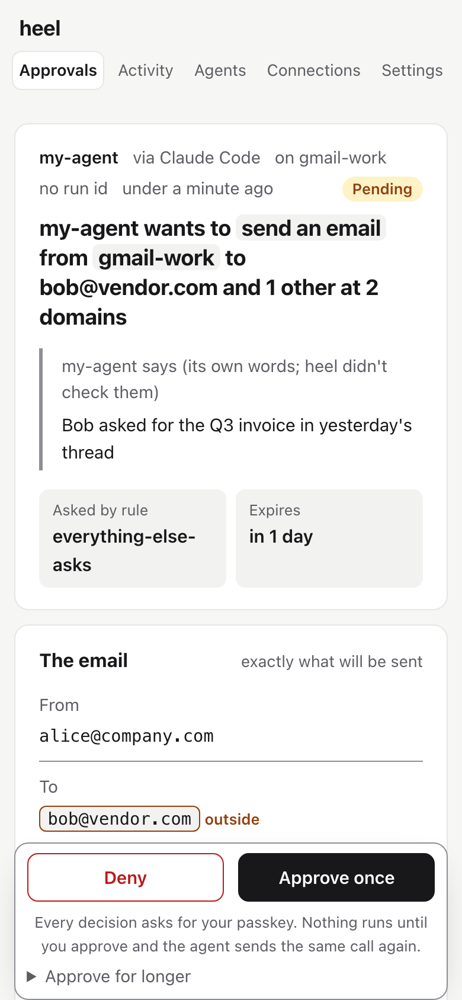

# Introduction

heel sits between your AI agents and the accounts they use: GitHub, Gmail, Slack, any MCP server, API or CLI. Your agent calls heel instead of the service. heel checks each call against your rules, runs it, blocks it, or asks you first. When it asks, you approve or deny from your phone with a passkey. The agent never holds your credentials.

## How it works

1. **Connect an account once.** heel keeps the credential encrypted. Your agent never sees it.
2. **Point your agent at heel.** It gets one MCP server with every account's tools, and a heel token instead of your keys.
3. **Write rules, or start with the defaults.** Reads run; everything else asks you. A call no rule matches is denied.
4. **Approve what asks.** heel shows you exactly what will happen, in plain words. Nothing runs until you approve.

## Start here

- **[Quickstart](quickstart.md):** heel running, an agent connected and your first approval, in about 10 minutes.
- **[Write rules](rules.md):** decide what runs on its own, what asks, and what never runs.
- **[Approve from your phone](approvals.md):** what an approval shows you, and approving for longer.
- **[Run heel on a server](running.md):** one heel for every machine you use.

heel is open source and runs on your own machine. Nothing goes through a heel cloud.
