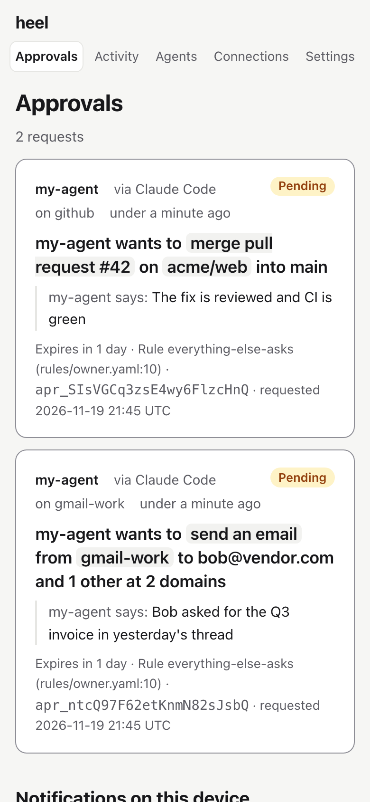
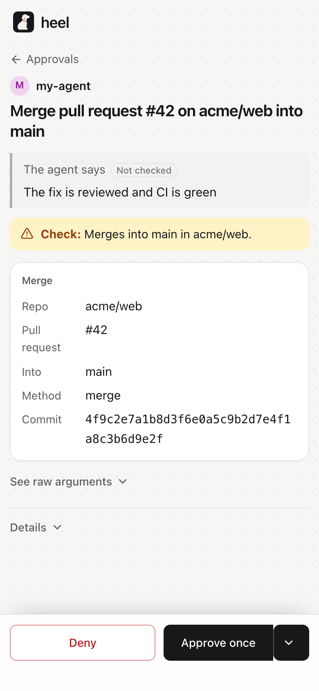

# Quickstart

Get heel running, connect GitHub, point your agent at heel and approve its first request. It takes about 10 minutes.

You need Node 26.13 or later and a GitHub token (`gh auth token` prints yours).

## 1. Install and set up heel

```sh
npm install -g useheel
heel init
```

`heel init` creates heel's home folder at `~/.heel` with a master key, a config file and starter rules:

```text
  created  ~/.heel
  created  ~/.heel/master.key
  created  ~/.heel/heel.yaml
  created  ~/.heel/rules/owner.yaml
```

Back up `master.key` somewhere off this machine. Without it, heel can't read the credentials it stores.

The starter rules let reads run and make everything else ask you.

## 2. Start heel

```sh
heel serve
```

```text
heel is running.
  Approve requests:   open http://localhost:7301
  Agents connect to:  http://127.0.0.1:7300/mcp
  Stop with Ctrl-C.
```

Leave it running, and use a second terminal for the next steps.

## 3. Create your passkey

```sh
heel user enroll owner
```

Open the link it prints and select **Create a passkey**. Touch ID, Windows Hello or a security key all work. Then sign in with it.


You'll use this passkey to approve requests. To approve from your phone instead, see [Approve from your phone](approvals.md).

## 4. Connect GitHub

```sh
gh auth token | heel connect github --as github --credential-stdin
```

`github` is the account's alias. Your agent only ever sees the alias, never the token.

## 5. Connect your agent

Add an agent and copy the token it prints. heel shows it once.

```sh
heel agent add my-agent
```

Then add heel to your agent as an MCP server:

**Claude Code**

```sh
claude mcp add --transport http heel "http://127.0.0.1:7300/mcp?tools=direct" \
  --header "Authorization: Bearer heel_…"
```

**Codex**

```sh
codex mcp add heel --url "http://127.0.0.1:7300/mcp?tools=direct" \
  --bearer-token-env-var HEEL_TOKEN
```

Set `HEEL_TOKEN` to the token first.

**Cursor, or any client with an `mcp.json`**

```json
{
  "mcpServers": {
    "heel": {
      "url": "http://127.0.0.1:7300/mcp?tools=direct",
      "headers": { "Authorization": "Bearer heel_…" }
    }
  }
}
```

Remove the agent's own GitHub access (its GitHub MCP server or `gh` login), or it can go around heel.

## 6. Approve your first request

Ask your agent to do something on GitHub. Reads run straight away. A write, like merging a pull request, waits for you:

> Merge pull request 42 on acme/web.

Open the **Approvals** page at http://localhost:7301. Each request says what the agent wants to do, in plain words, with the agent's own reason:



Open it to see exactly what will run. Select **Approve once** and confirm with your passkey:



The agent checks back and sends the call again, and this time it runs. Every decision shows up under **Activity**.

## Next steps

- **[Write rules](rules.md):** let the calls you always approve run on their own.
- **[Approve from your phone](approvals.md):** give heel an HTTPS address and get notifications.
- **[Connect more accounts](connect.md):** Gmail, Slack, Linear, any MCP server, API or CLI.
- **[Run CLIs through heel](heel-run.md):** `gh`, `kubectl` and others, without the agent holding the token.
