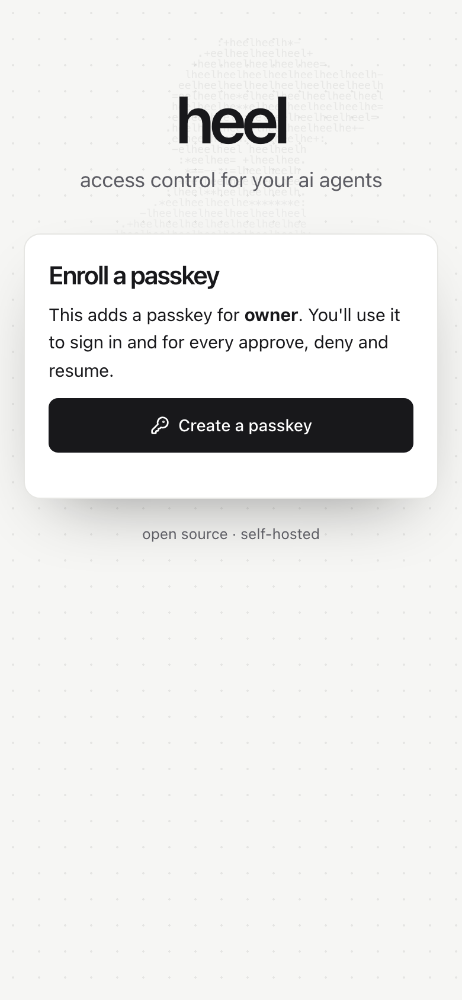
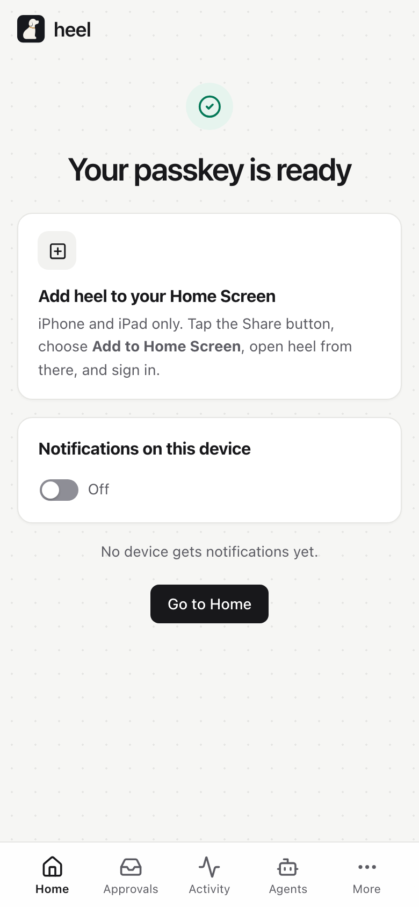

# Quickstart

At the end of this page heel is running, an agent reaches your accounts through it, and you've approved its first request.

There are two ways: give your agent one line and approve what it asks for (recommended), or do each step by hand.

## Ask your agent

Tell Claude Code, Codex or any coding agent:

```text
Set up heel for me: run curl -fsSL https://useheel.dev/setup.md and follow it
```

It asks where heel should run: on a server you use (the safest place), on a server where heel already runs, or on this computer. It installs heel there (over SSH, if you let it), connects itself, finds the services you use and asks heel to connect each one. The agent never reads a key's value and never connects an account or writes a rule itself.

You do this:

1. **Make your passkey.** Open the link the agent gives you and choose **Create a passkey** (Touch ID, Windows Hello or a security key).
2. **Load heel in your agent.** In Claude Code, run `/mcp` or restart. With heel on a server, pick heel in `/mcp`, choose **Authenticate** and confirm with your passkey. If you restart, give it the same line again; it picks up where it left off.
3. **Approve what it asks for** on heel's approval page: each connection (sign in, or paste the service's key on heel's page) and each rule it proposes.
4. **Remove the old keys** with it, one change at a time.

Already connected to heel? In Claude Code run `/mcp__heel__setup` (other agents: heel's `setup` prompt) to start at finding your services.

### The prompt

This is what the agent reads at useheel.dev/setup.md.

```text
Set up heel for me. heel is a permission gateway: you'll reach my accounts through it, it holds their keys, and I approve anything risky with a passkey. Go step by step and tell me what you're doing.

Some steps may be done already, for example if I restarted you partway: check each one first and skip it if it's done. If heel's tools (such as heel_accounts) are already available to you, skip straight to the part after step 6.

Rules for the whole task:
- Never read, print, copy or send the value of a key, token, password or secret. The one exception is heel's own token for you in step 5, if heel prints it: pass it straight to the command that adds heel to your app, and don't repeat it in our chat.
- Use heel's command line only for the steps below. Don't run heel connect, edit heel's rules files or approve anything yourself: connections and rules go through me.
- Don't install system software, edit shell profiles or change files outside heel without asking me first, here or on a server.

0. Ask me where heel should run:
   - on a server I use (a VPS, a Mac mini, a home server) where heel isn't set up yet. This is the safest place: agents on my computers can't reach heel's files, and every computer I use can share one heel;
   - on a server where heel already runs;
   - on this computer.
   If heel already runs on a server, skip to step 5. If it goes on a new server, ask how you reach it (for example ssh my-server) and whether you may run commands there. When you ask, tell me plainly: with that ssh access you can read heel's files on the server, including its master key, for as long as you keep it, so heel only holds you to its rules once your ssh login can't read heel's home (heel under its own user there, see https://useheel.dev/docs/running) or I take the access away. If I say yes, do steps 1 to 4 on the server, running each command in a login shell, as ssh <host> '$SHELL -lc "<command>"' (a plain ssh command misses PATH entries such as Homebrew's). In step 3, check Tailscale or cloudflared on the server, not here, and don't offer "this computer only": I'll approve from my phone. If neither is on the server, stop and tell me. If I'd rather you didn't use ssh, ask me to give this same line to an agent on the server (or to run steps 1 to 4 there myself) and to tell you heel's agent address when it's done; then continue at step 5.

1. Check Node: node -v must be 26.13 or later. If it's older or missing, ask me, then upgrade it the way that machine gets Node (brew upgrade node, mise or nvm) before step 2, or tell me to install it from nodejs.org.

2. If heel --version fails, install heel: npm install -g useheel

3. Ask me where I'll approve from: this computer only; my phone and other devices over Tailscale (Tailscale installed and signed in here); or anywhere through a Cloudflare tunnel on a domain I have on Cloudflare (cloudflared installed and cloudflared tunnel login done here; ask me for the hostname, like heel.example.com). Don't install either yourself: if what I pick isn't there, say so and offer this computer for now. Then set heel up and start it: heel init --yes --approve-from this-computer (or --approve-from tailscale, or --approve-from cloudflare --hostname <hostname>), then heel start. If heel init stops with a problem, tell me what it says. Run heel status to check it's running.

4. My passkey: run heel user enroll owner and give me the link it prints. Ask me to open it (on my phone, if I chose Tailscale or Cloudflare) and choose Create a passkey, then turn on the notifications switch on the welcome page that follows. Wait until I say I'm done, then run heel status and check that Passkeys is 1 or more.

5. Add yourself as an agent.
   - If heel runs on this computer: heel agent add <a short name for you, like claude-code> --client claude-code. heel adds itself to Claude Code for every project, and the token goes straight into Claude Code's config, so you never see it. If heel says it couldn't, run the command it prints instead. For Codex, use --client codex and run the commands it prints. For any other app, leave out --client and tell me the MCP URL to add, with the token as a bearer token.
   - If heel runs on a server: there's no token. Use heel's agent address, the one heel init printed after "Agents on your other machines connect at"; it ends in /mcp, so use it as it is (ask me for it if you don't have it). Add it as a remote MCP server that signs in: heel names the agent after your app, and I confirm on heel's sign-in page with Connect with a passkey (if my passkey is on my phone, the browser offers a QR code). In Claude Code: claude mcp add --transport http --scope user heel <address>. Your session can't sign in, so ask me to run claude mcp login heel in my own terminal (with no browser there: claude mcp login heel --no-browser, open the link it prints and paste back where the browser lands). Then check that claude mcp list no longer says Needs authentication for heel. In Codex: codex mcp add heel --url <address>; it opens heel's sign-in page itself, and only if it doesn't, run codex mcp login heel.

6. This session doesn't have heel's tools yet. Ask me to reload it (in Claude Code, /mcp) or to start a new session and give it this same line. Then check that heel's tools are there, such as heel_accounts.

If heel runs on this computer, it runs as me, so you could still read its files. When we're done, tell me that heel is safest under its own user or on a server, and point me to https://useheel.dev/docs/running. If you set heel up on a server over ssh, remind me that you can still read heel's files there until I move heel under its own user or take your ssh access away.

Once heel's tools are loaded, carry on:

Help me put the services I use behind heel, so you reach them through heel and never hold their keys.

Rules for the whole task:
- Never read, print, copy or send the value of a key, token, password or secret, never ask me for one, and never put one in a command you run. You may look at names only: environment variable names, which config files exist, which servers an MCP config lists.
- Don't edit, move or delete any file or setting without asking me first.
- Everything you ask heel for waits for me. I approve each request on heel's approval page with my passkey.

1. Call heel_accounts to see what's already behind heel and what's still waiting.

2. Find the services I use, by name only:
   - environment variables such as GH_TOKEN, GITHUB_TOKEN, SLACK_BOT_TOKEN, LINEAR_API_KEY, NOTION_TOKEN, STRIPE_API_KEY (names only, never values);
   - the gh CLI's login (whether ~/.config/gh/hosts.yml exists);
   - the MCP servers in your own client's config, and which of them carry a token;
   - .env files in the project I'm working in (variable names only).
   Tell me what you found as a short list: service, where its key lives now. Leave out anything already behind heel.

3. For each one heel can hold, call heel_request_connection with a short alias and a one-line why. heel takes Gmail, Google Calendar, Outlook, remote MCP servers on public https hosts, and GitHub, Slack, Linear, Notion and Stripe, which take a key I make. For anything else, tell me it stays as it is.
   Before you request one that takes a key, tell me:
   - where: GitHub https://github.com/settings/personal-access-tokens/new (an org may have to approve the token), Slack https://api.slack.com/apps (an app's bot token, xoxb-), Linear https://linear.app/settings/account/security, Notion https://www.notion.so/my-integrations (then share the pages it needs with it), Stripe https://dashboard.stripe.com/apikeys (a restricted key, rk_);
   - the least access our work needs (only those repositories, teams or pages, read-only where that's enough) and a short expiry;
   - for GitHub, that gh auth token works too: nothing to make, but heel then holds all my gh login can do, which matters if heel's host or a rule goes wrong, and it's revoked only along with every gh login. heel's rules gate your calls either way, so let me choose;
   - that I can paste it on heel's page, or pipe it in from my own terminal, such as pbpaste | heel connect github --as github --credential-stdin after I copy it (through ssh, as you ran heel, if heel is on a server). The command doesn't settle a request, so request only what I'll paste, and check heel_accounts after I run the command.

4. Rules. heel's starter rules (from heel init) already let reads run and ask me for everything else, so a new account is safe without new rules. Propose rules with heel_propose_rules only where I'd want something different, such as a routine write I'd otherwise approve every time, or something to block outright. One short why per rule, and keep it to the work I do with you. If none are needed, say so.

5. Tell me what's waiting for me and where to approve it. Then call heel_accounts with {"wait": true}: it answers once I've decided something. Keep calling it that way until nothing is waiting, telling me as each account connects. Don't ask me to tell you when I've approved.

6. Once an account works through heel (a read on it runs), walk me through removing the old key or login it replaces, so you can't go around heel: which variable, file, MCP config entry or gh login to change. Show me each change first; make it only if I say yes. You can't see which key I gave heel, so suggest revoking an old one with the service only after I say heel doesn't hold it. If heel holds my gh login's token, gh auth logout is fine (it doesn't revoke the token), but revoking GitHub CLI on GitHub would cut heel off.

Finish with a short summary: what's behind heel now, what's still waiting, and what still holds its own key.
```

## By hand

You need Node 26.13 or later and a GitHub token (`gh auth token` prints yours). This runs heel on your own computer; for daily use, put it on a server every computer can share: see [Running heel](running.md).

1. Install heel and create its home folder (`~/.heel`, with a master key, a config file and starter rules that let reads run and ask for everything else). Back up `~/.heel/master.key` off this machine: without it heel can't read the credentials it stores.

   ```sh
   npm install -g useheel && heel init
   ```

2. Start heel in the background. It prints where to approve (`http://localhost:7301`) and where agents connect (`http://127.0.0.1:7300/mcp`). `heel logs -f` follows its log.

   ```sh
   heel start
   ```

3. Create your passkey. Open the link it prints, choose **Create a passkey**, and turn on notifications on the welcome page.

   ```sh
   heel user enroll owner
   ```

   

   

4. Connect GitHub. `github` is the alias your agent sees; it never sees the token.

   ```sh
   gh auth token | heel connect github --as github --credential-stdin
   ```

5. Add your agent. For Claude Code, heel adds itself and puts the token straight into Claude Code's config. For other agents, see [Connect your agent](agents.md).

   ```sh
   heel agent add my-agent --client claude-code
   ```

   Then remove the agent's own GitHub access (its GitHub MCP server or `gh` login), or it can go around heel.

6. Approve your first request. Ask your agent to merge a pull request: reads run straight away, writes wait for you. Open **Approvals** at http://localhost:7301, open the request, choose **Approve once** and confirm with your passkey.

   

   

## Done when

The agent's waiting call runs as soon as you approve, and it shows up under **Activity**.

## Next

- **[Write rules](rules.md):** let the calls you always approve run on their own.
- **[Approve requests](approvals.md):** approve from your phone and get notifications.
- **[Connect accounts](connect.md):** Gmail, Slack, Linear, any MCP server, API or CLI.
