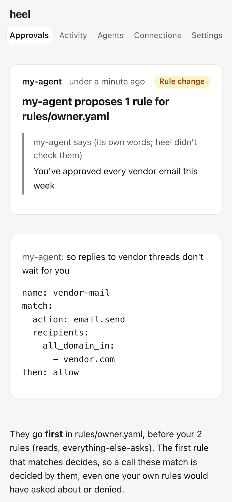

# Write rules

Rules decide what each agent call does: it runs, it asks you, or it never runs. This page covers writing, testing and changing them.

Your rules are a YAML file at `~/.heel/rules/owner.yaml`. `heel init` starts you with two: reads run, everything else asks you. Every key, operator and action is in the [rules reference](rules-reference.md).

## How heel decides

The first rule that matches decides. A call no rule matches is denied. heel checks, in this order:

- **Organization rules.** They can only deny or ask, so nothing below loosens them.
- **Your rules,** top to bottom.
- **Standing approvals and grants,** only where your rules end in `ask` (a grant also where nothing matched). They can turn it into `allow`, never get past a `deny`.

## A rules file

```yaml
rules:
  # reads: anything a built-in definition marks as read-only
  - match: { kind: read }
    then: allow

  # the personal account never emails clients
  - match:
      action: email.send
      account: gmail-personal
      recipients:
        any_domain_in: [clientco.com, partner.io]
    then: deny

  # coworkers already in the thread: no need to ask
  - match:
      action: email.send
      account: gmail-work
      recipients:
        all_in_thread: true
        all_domain_in: [company.com]
        max: 5
    then: allow

  # every other send, including reply-all to a customer
  - match: { action: email.send }
    then: ask

  # trash, delete, and archive count messages, not calls
  - match: { action: email.remove, items: { over: 20, per: run } }
    then: ask
  - match: { action: email.remove, items: { over: 100, per: hour } }
    then: ask
  - match: { action: email.remove }
    then: allow

  - match: { action: github.merge, repo: { one_of: [acme/web, acme/api] }, checks: passing }
    then: allow

  - match: { command: kubectl, verb: { one_of: [get, describe, logs] } }
    then: allow
  - match: { command: kubectl, verb: delete }
    then: ask
```

## What a rule can check

| Part | What it does |
| --- | --- |
| **Actions** | One name across services: `email.send` covers send, reply, reply-all and forward on Gmail and Outlook. For a server heel doesn't know, use its own tool and argument names. |
| **Plain checks** | `equals`, `one_of`, `matches`, `any_domain_in`, `all_domain_in`, `max`. |
| **State checks** | heel looks something up first: `all_in_thread` (every recipient was on a message you sent in the thread), `checks: passing` (the pull request's checks pass, and the merge is pinned to that commit). |
| **Counts** | Count items, not calls: one delete of 1,000 messages counts as 1,000. Pair `per: run` with a `per: hour` limit, which the agent can't reset. |

The full list is in the [rules reference](rules-reference.md).

## Try rules before enforcing them

Watch mode lets calls through that your rules would deny or ask about, and marks each one in **Activity** as "would deny" or "would ask".

- **Everyone:** `heel start --watch` (or `heel restart --watch`).
- **One person or the org default:** **Settings**, **Modes** (admins). Watch asks for your passkey; Enforce doesn't.
- **One rule:** add `watch: true` to it.

Pause, org rules, hidden mail and calls heel can't check safely still apply in Watch mode.

## Change your rules

**In the web app:** **Activity**, **Rules** lists your rules as sentences, in the order heel reads them.

1. Pick a new decision from a rule's dropdown, or remove it with the trash icon.
2. Read the change: your rules in words afterwards, and the lines that change in the file.
3. Save with your passkey.

**Edit the file directly** (a fold under the list) opens the YAML, with the same check before saving. **Activity**, **Rule history** shows every change, newest first, including edits made outside heel.

**In the file:** heel reloads it on its own. Before you rely on a change, run:

```sh
heel rules check
heel rules test
```

`heel rules check` reports problems and names that match nothing; `heel rules test` runs your test cases ([how](rules-reference.md#testing-rules)). Editing a rule ends the standing approvals made from it.

## Your agent can propose rules

When a call keeps asking or is denied, your agent can propose rules, hide entries, or folders for its own `heel run`, with heel's `heel_propose_rules` tool. Each line needs a `why`, one plain sentence you read next to it.



- **Nothing changes until you add it.** heel notifies you, and the proposal waits under **Rule changes** on **Approvals**. Its page says what each rule does in plain words, written by heel from the rule itself, then the agent's why and the file after the change. **Add these rules** asks for your passkey.
- **Proposed rules go first in your file,** so a proposed `allow` decides before your own rules. The page says so.
- **heel writes the file, never the agent.** The agent sends rule objects for its own owner's file only and never sees your file.
- **The passkey signs the exact file.** If the file changes before you confirm, nothing is written.
- **One proposal per agent waits at a time,** and it expires after 7 days.

## heel suggests rules from what you decide

When you approve the same kind of request 5 times on at least 2 different days in the last 30, heel suggests a rule that stops the asking. Denials suggest a deny rule the same way.

- **Where:** a card under **Suggested rules** on **Approvals** and **Activity**, with what the rule does and what it rests on.
- **Nothing changes until you add it:** **Review and add** opens it as a rule change you save with your passkey. **Don't suggest this again** stops it.
- **Never wider than what you approved:** it names the agent, account, action and tool, and the exact repo, calendar or recipients those requests shared. It goes right before the rule that asked, so every rule above it still decides first.
- **Agents see it too:** `heel_history` shows an agent how you decided its own requests, and it can ask for a suggestion by id.

Change the numbers or turn suggestions off with `learning` in [configuration](configuration.md).

## Hiding what the agent reads

Rules decide whether a call runs. `hide` decides what comes back, on every allowed call and every account.

```yaml
hide:
  # mail from family never reaches the agent
  - email: { from: { any_of: [sarah@example.com] } }
  # neither do password resets or login codes
  - email: { looks_like: [password_reset, login_code] }
```

- **Hidden messages drop out** of searches, lists and threads, with a placeholder saying how many. Fetching, forwarding, replying to or deleting one is denied.
- **`looks_like`** is the one place a model judges a live call, and it can only hide. When it's unsure, the message is hidden.
- **Where it works:** built-in services and OpenAPI-described APIs, where heel knows the response shape. For other MCP servers and CLIs, heel can allow or deny but can't remove items.

[`examples/rules/owner.yaml`](../examples/rules/owner.yaml) holds this page's example rules and hide entries.
